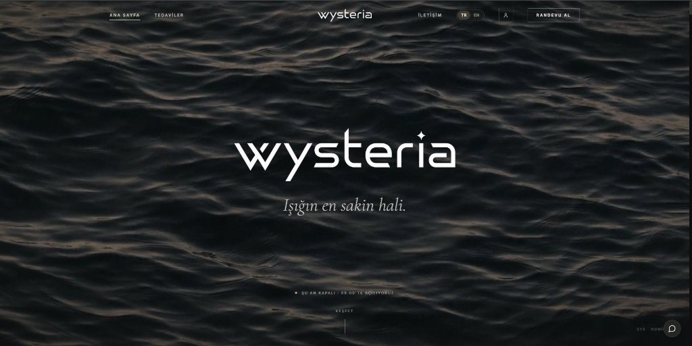
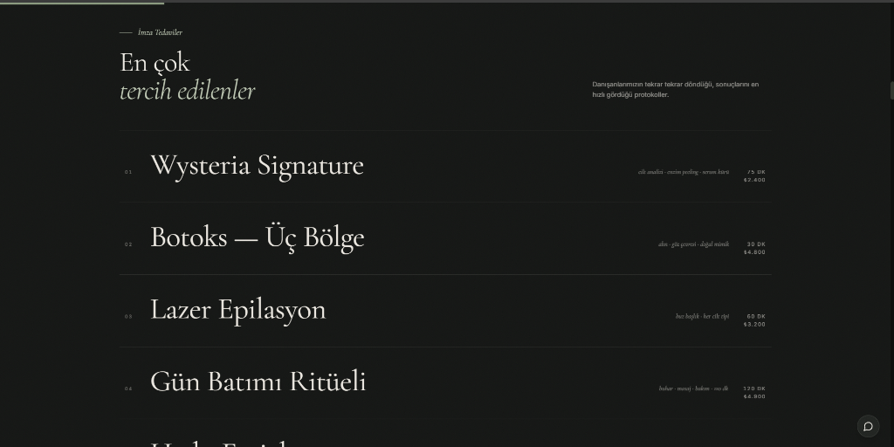
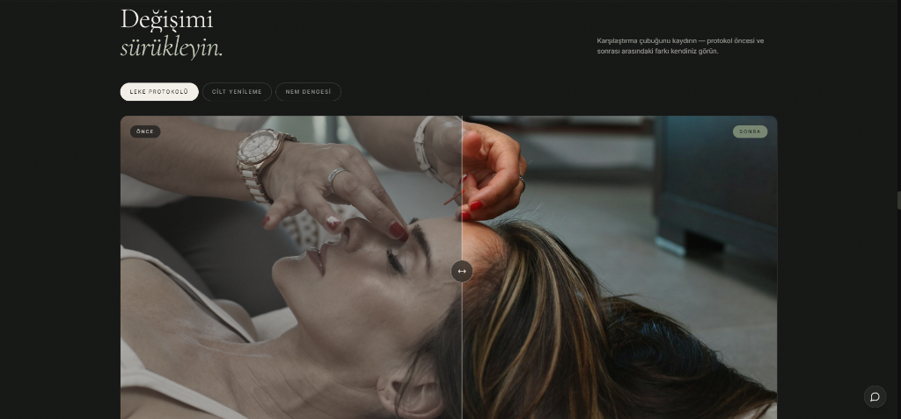

# Wysteria Works — Clinic

Klinikler ve medikal estetik merkezleri için hazırlanmış tek sayfalık bir dijital vitrin çalışması. Koyu, monolitik bir zemin üzerine kurulu; amaç ziyaretçiye kliniğin güvenini, sükûnetini ve profesyonelliğini ilk ekrandan hissettirmek.

**Canlı önizleme:** https://wysteria-works-clinic.vercel.app/

## Konsept

Site klasik medikal şablonlardan bilinçli olarak uzaklaşıyor. Metin hiyerarşisi editoryal, renk dili sakin; sayfa, ziyaretçiyi acele ettirmek yerine kliniğin ritmine davet ediyor. Türkçe ve İngilizce içerik aynı çatı altında sunuluyor.

## Bölümler

- **Portal hero** — sıvı obsidan görsel dille açılan karşılama sahnesi
- **Manifesto** — kliniğin yaklaşımını özetleyen kısa metin bloğu
- **İmza tedaviler** — satır bazlı liste düzeni; satır üzerine gelindiğinde tedaviye ait görsel imleci takip ediyor
- **Bilim** — cilt katmanlarını katman katman anlatan kaydırmalı sahne
- **Sonuçlar** — sürüklenebilir önce/sonra karşılaştırma çerçevesi ve vaka seçimi
- **Mekân & galeri** — karartılmış mimari görseller, lightbox desteği
- **Ekip & danışan sesleri** — monogramlı ekip kartları ve alıntı düzeni
- **Ziyaret** — gerçek Google Maps gömülü harita, adres ve yol tarifi bağlantıları
- **Randevu** — kenardan açılan concierge randevu çekmecesi ve WhatsApp hattı

## Teknik yapı

React 18 · TypeScript · Vite · Tailwind CSS · GSAP + ScrollTrigger · Lenis pürüzsüz kaydırma · React Router · TR/EN dil desteği

Kaydırma koreografisi `prefers-reduced-motion` tercihine saygılı; mobilde ağır pin ve paralaks sahneleri sadeleştiriliyor.

## Not

Sitedeki tedavi isimleri, fiyatlar ve içerikler vitrin amaçlı temsilidir; gerçek bir klinik yayınına taşınırken kurumun kendi bilgileriyle güncellenmesi yeterlidir.
